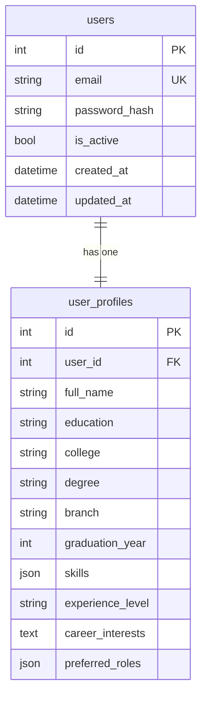
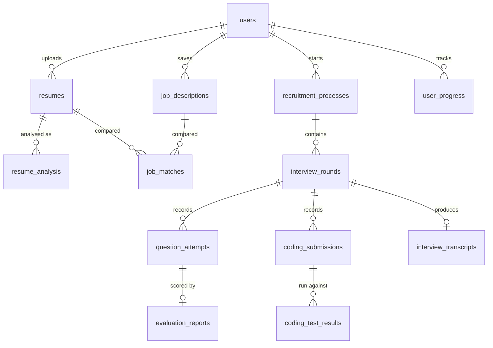

# Database design (current: Phase 2)

Deleting a user deletes their profile (ON DELETE CASCADE). Passwords are stored only as bcrypt hashes.
`graduation_year` has a CHECK constraint (1980-2100); `user_profiles.user_id` is unique.

## Planned relationships (added with each module)

Every user-owned table will carry `user_id` and every query will filter on it.
